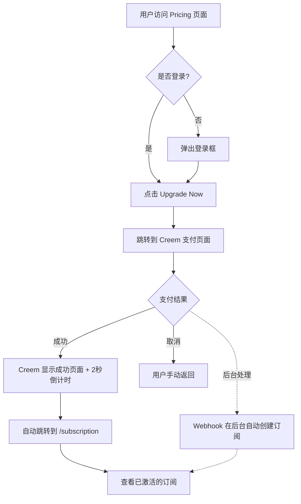
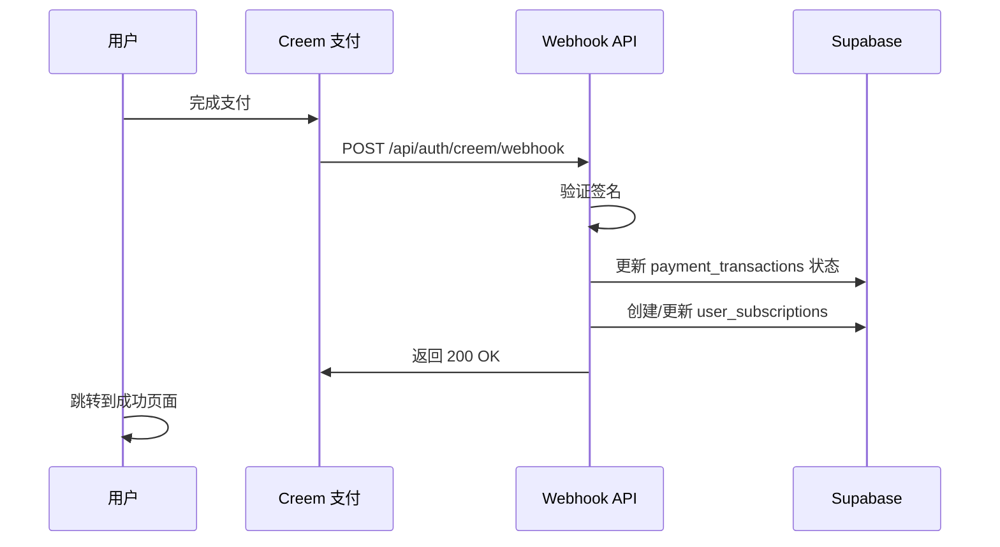

# Creem 支付配置指南

## 🔧 Webhook 端点

**Webhook URL（必须在 Creem Dashboard 配置）：**
```
https://www.professionalheadshotai.ink/api/auth/creem/webhook
```

## 📦 产品配置

### Professional Plan
- **Product ID**: `prod_3VuEcSLV7nUFQIFYByNkaG`
- **Price**: $9.99
- **Quota**: 50 images + 5 bonus

### Executive Plan
- **Product ID**: `prod_3goNXcJoP80L3mmWoAdkZs`
- **Price**: $29.99
- **Quota**: 200 images + 20 bonus

## ⚙️ Creem Dashboard 配置步骤

### 1. 配置 Webhook

登录 [Creem Dashboard](https://dashboard.creem.io)，进入 **Webhooks** 设置：

1. 点击 "Add Webhook"
2. **Webhook URL**: `https://www.professionalheadshotai.ink/api/auth/creem/webhook`
3. **Events to listen**:
   - ✅ `payment.completed`（支付成功）
   - ✅ `payment.failed`（支付失败）
   - ✅ `payment.refunded`（退款）
4. 保存后会生成 **Webhook Secret**，复制它

### 2. 支付跳转说明

✅ **Creem 支持自动跳转**：支付成功后会自动跳转到指定的 `return_url`

1. 用户完成支付后，Creem 显示成功页面
2. 页面会显示 "Returning to Merchant in 2s" 倒计时
3. 2秒后自动跳转回我们的网站 `/subscription` 页面
4. 同时 Webhook 在后台自动处理订阅创建
5. 用户在订阅页面可以看到已激活的套餐

我们在支付链接中传递 `return_url` 参数，指向 `/#/subscription` 页面。

### 3. 获取 API 密钥

在 Creem Dashboard 的 **API Keys** 页面：

1. 复制 **API Key**（用于创建支付订单）
2. 复制 **Webhook Secret**（用于验证 webhook 签名）

## 🔐 环境变量配置

在 **Vercel** 项目设置中添加以下环境变量：

```bash
# Creem API 配置
CREEM_API_KEY=creem_sk_xxxxxxxxxxxxx
CREEM_WEBHOOK_SECRET=whsec_xxxxxxxxxxxxx

# Supabase 配置（如果还没有）
NEXT_PUBLIC_SUPABASE_URL=https://your-project.supabase.co
SUPABASE_SERVICE_ROLE_KEY=eyJhbGciOiJIUzI1NiIsInR5cCI6IkpXVCJ9...

# 应用 URL
APP_URL=https://www.professionalheadshotai.ink
```

## 📋 支付流程

### 用户操作流程



### Webhook 处理流程



## 🧪 测试 Webhook

### 使用 ngrok 本地测试

1. 安装 ngrok:
   ```bash
   npm install -g ngrok
   ```

2. 启动本地开发服务器:
   ```bash
   pnpm dev
   ```

3. 创建隧道:
   ```bash
   ngrok http 3000
   ```

4. 在 Creem Dashboard 配置临时 webhook:
   ```
   https://xxxx.ngrok.io/api/auth/creem/webhook
   ```

5. 进行测试支付并观察控制台日志

### 使用 Creem CLI 测试 Webhook

```bash
# 安装 Creem CLI
npm install -g @creem/cli

# 触发测试 webhook
creem webhooks test \
  --endpoint https://www.professionalheadshotai.ink/api/auth/creem/webhook \
  --event payment.completed
```

## 🔍 监控和调试

### 查看 Webhook 日志

在 Creem Dashboard 的 **Webhooks** 页面：
- 查看所有 webhook 请求历史
- 查看响应状态码
- 查看重试记录
- 手动重新发送失败的 webhook

### 查看 Vercel 日志

```bash
vercel logs
```

或在 Vercel Dashboard 查看 Function 日志

### 常见问题排查

#### Webhook 签名验证失败
- 检查 `CREEM_WEBHOOK_SECRET` 环境变量是否正确
- 确认使用的是正确的密钥（Production vs Test）

#### 订阅未创建
- 检查 `user_id` 和 `plan_type` 是否正确
- 查看 Supabase 数据库日志
- 确认 `subscription_plans` 表中有对应的套餐配置

#### 支付成功但没跳转
- 检查产品的 Success URL 配置
- 确认 `return_url` 参数格式正确
- 查看浏览器控制台是否有错误

## 📧 联系支持

如有问题，请联系：
- **技术支持**: support@professionalheadshotai.ink
- **Creem 支持**: support@creem.io

## ✅ 配置清单

完成所有配置后，请确认：

- [ ] Webhook URL 已在 Creem Dashboard 配置
- [ ] Webhook Secret 已添加到 Vercel 环境变量
- [ ] CREEM_API_KEY 已添加到环境变量
- [ ] SUPABASE_SERVICE_ROLE_KEY 已添加到环境变量
- [ ] NEXT_PUBLIC_SUPABASE_URL 已配置
- [ ] 数据库迁移已执行（subscription_plans、user_subscriptions、payment_transactions 表）
- [ ] 使用测试支付验证整个流程
- [ ] 查看 webhook 日志确认数据正确写入
- [ ] 用户可以在 /subscription 页面看到购买的套餐

---

**最后更新**: 2025-12-14

